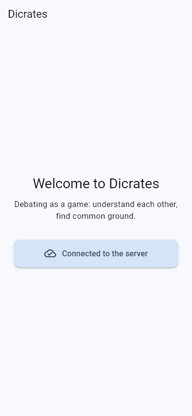
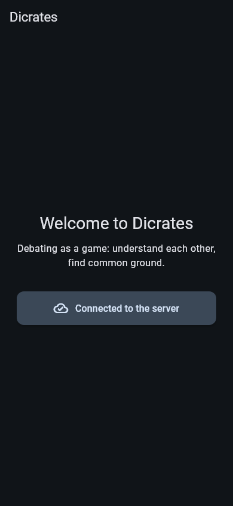
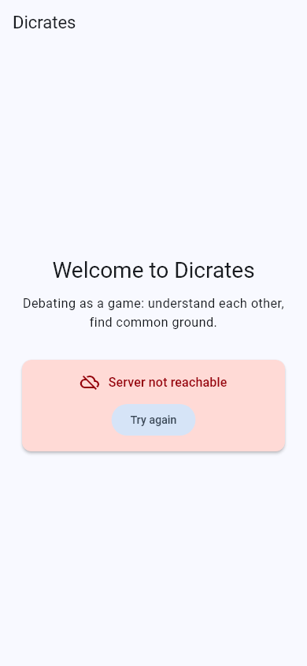

# Dicrates

**Debating as a game.** *Discus + Socrates: "I know that I know nothing."*

Dicrates brings small anonymous groups together around a current, concretely worded question. Over four asynchronous rounds everyone states a position, reads an AI-written picture of how the group sees it, can revise their view, and ends with a compromise proposal. Points reward good arguments, openness and finding common ground, not being right.

> Status: early setup, nothing playable yet.

## Repository

| Folder | What |
|---|---|
| `app/` | Flutter mobile app (Android, iOS) |
| `backend/` | Python FastAPI API and job worker |
| `website/` | Landing page (Astro, GitHub Pages) |
| `docs/` | Architecture, testing, conventions, project brief |
| `Roadmap/` | Roadmap to production (task files for AI agents, status, cross-task notes; German) |

Contributors and AI coding agents start with [AGENTS.md](AGENTS.md).

## Quick start

```bash
cp .env.example .env          # fill in your own keys
cd backend && uv sync && uv run pytest
cd backend && uv run uvicorn dicrates.main:app --reload   # API on :8000
cd app && flutter pub get && flutter test
cd app && flutter run --dart-define=API_BASE_URL=http://10.0.2.2:8000   # Android emulator → local API
cd website && npm ci && npm run dev
```

## Screenshots

Rendered automatically from the app's golden tests (`app/screenshots/`, invented demo data).

| Start (light) | Start (dark) | Server unreachable |
|---|---|---|
|  |  |  |

## License

[GNU AGPL-3.0](LICENSE)
